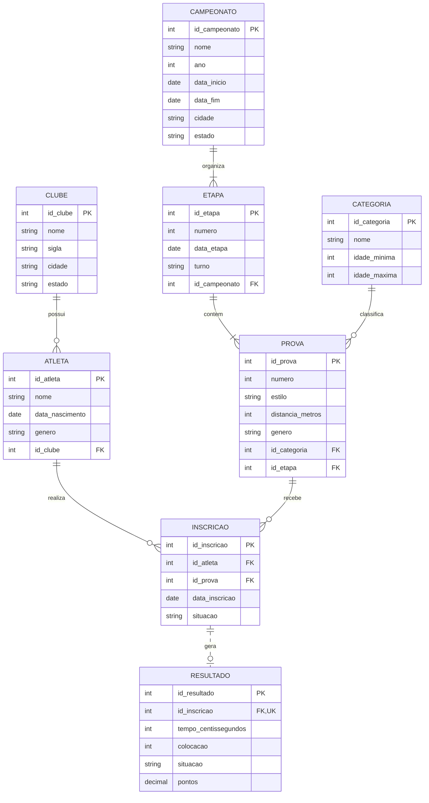

# 29º Troféu Alexandre Pussieldi — 2025

**Disciplina:** Banco de Dados  
**Atividade:** Modelagem de Dados e Prompt Inverso  

## Integrantes
- Pedro Lucas Trevisan Streit
- Enzo Kail Vizalli
- Caio Negretti
- Eduardo Guimarães Lima

## Introdução e fontes

Este trabalho apresenta um **modelo relacional proposto** para registrar campeonatos, clubes, atletas, categorias, provas, inscrições e resultados, seguido de duas procedures de consulta estatística em **PostgreSQL (PL/pgSQL)**.

O regulamento do XXIX Festival Nordestinho de Natação — Troféu Alexandre Azambuja Pussieldi, Maceió/AL, 2025 — identifica as categorias **Pré-Mirim, Mirim I e Mirim II**. O enunciado da atividade resume as faixas como Pré-Mirim (até 9 anos) e Mirim (10–11 anos). No banco, as faixas são parametrizadas na tabela `CATEGORIA`, sem presumir automaticamente as idades exatas das subdivisões Mirim I e II. A idade deve ser calculada conforme a **data-base definida pelo regulamento**, a confirmar antes de importar dados oficiais.

Fontes:
- [FASE Aquática](https://faseaquatica.com.br/)
- [Regulamento específico 2025 (sistema de relatórios aquáticos)](https://sge-aquaticos.bigmidia.com/_uploads/relatorios/49ae0ced8b62ce7a574cb32c94cf36df.pdf)
- [Mermaid — sintaxe ER](https://mermaid.js.org/syntax/entityRelationshipDiagram.html)
- [Mermaid Live Editor](https://mermaid.live/)

> **Limite da validação:** este modelo não é uma exportação do banco interno da FASE Aquática. Os dados reais de inscrições, provas, resultados e regras de premiação precisam ser conferidos na fonte antes de se afirmar que as estatísticas representam o campeonato de 2025.

---

## Questão 1 — Diagrama Entidade-Relacionamento (MERMAID)



### Entidades e decisões de modelagem

| Entidade | Finalidade |
|---|---|
| `CAMPEONATO` | Identificar edição, ano, datas e sede. |
| `CLUBE` | Identificar as equipes. |
| `CATEGORIA` | Registrar faixas etárias parametrizadas. |
| `ATLETA` | Registrar nadadores e seu clube no modelo simplificado. |
| `ETAPA` | Organizar provas por dia e turno. |
| `PROVA` | Registrar estilo, distância, gênero e categoria. |
| `INSCRICAO` | Resolver a relação N:N entre atletas e provas. |
| `RESULTADO` | Registrar tempo, colocação, situação e pontos, quando houver. |

**Cardinalidades:** um clube pode ter zero ou muitos atletas; cada atleta possui um clube no modelo simplificado. Uma prova recebe várias inscrições e um atleta pode inscrever-se em várias provas. Cada inscrição pode gerar zero ou um resultado; a unicidade de `RESULTADO.id_inscricao` impede duplicação. Os relacionamentos usam linha sólida para dependências identificadoras adotadas no modelo conceitual e tracejada para a relação opcional inscrição–resultado. **Nota técnica:** como as entidades têm PK próprias, o uso de linha sólida aqui é uma convenção visual e não significa que as FKs componham suas PKs; uma modelagem estritamente identificadora pode usar linhas tracejadas em todas essas relações.

**Normalização:** atributos são atômicos (1FN); cada tabela tem chave primária simples (2FN); dados de clube, categoria e campeonato não são repetidos nas inscrições ou resultados (3FN). Os campos de medalha não são armazenados, pois são derivados das colocações válidas.

**Limitações:** revezamentos, mudança de clube ao longo do tempo, desempates e regras de pontuação/premiação requerem validação específica. O modelo e as consultas a seguir tratam **resultados individuais** e consideram, para fins de exercício, colocação 1/2/3 como ouro/prata/bronze. Isso não substitui o regulamento de premiação.

---

## Questão 2 — Prompt inverso e procedures SQL

### 2.1 Objetivo

- `sp_quatro_de_migalhas`: retornar, por clube, contagens de medalhas de ouro, prata e bronze de resultados válidos.
- `sp_atlas_e_cubos`: retornar, por clube, número de atletas distintos, inscrições, resultados válidos, pontos somados e melhor tempo registrado.

Os nomes foram mantidos **exatamente** como exigidos. As procedures foram desenvolvidas para PostgreSQL. Como `PROCEDURE` não retorna linhas diretamente como uma função, utilizamos **parâmetro `INOUT refcursor`**, que permite consultar as linhas com `FETCH` na mesma transação.

### 2.2 Pré-requisitos

O banco precisa conter as oito tabelas do diagrama, com as colunas e tipos compatíveis. As duas procedures consultam somente dados existentes: **não criam dados de atletas ou resultados**. O parâmetro `p_campeonato` é o identificador da edição que se deseja analisar.

Para as consultas, consideramos `RESULTADO.situacao = 'VALIDO'`. Essa convenção de valor deve ser ajustada caso a base utilize outro código para resultados válidos.

### 2.3 Procedure `sp_quatro_de_migalhas`

```sql
-- PostgreSQL / PLpgSQL
-- Estatistica de medalhas por clube e campeonato.
-- Premissa didatica: colocacoes 1, 2 e 3 equivalem a ouro, prata e bronze.
-- Somente resultados com situacao = 'VALIDO' entram na contagem.
CREATE OR REPLACE PROCEDURE sp_quatro_de_migalhas(
    IN p_campeonato INTEGER,
    INOUT p_resultado REFCURSOR
)
LANGUAGE plpgsql
AS $$
BEGIN
    OPEN p_resultado FOR
        SELECT
            c.id_clube,
            c.nome AS clube,
            COUNT(*) FILTER (WHERE r.colocacao = 1) AS ouro,
            COUNT(*) FILTER (WHERE r.colocacao = 2) AS prata,
            COUNT(*) FILTER (WHERE r.colocacao = 3) AS bronze,
            COUNT(*) FILTER (WHERE r.colocacao BETWEEN 1 AND 3) AS total_medalhas
        FROM clube AS c
        JOIN atleta AS a ON a.id_clube = c.id_clube
        JOIN inscricao AS i ON i.id_atleta = a.id_atleta
        JOIN resultado AS r ON r.id_inscricao = i.id_inscricao
        JOIN prova AS p ON p.id_prova = i.id_prova
        JOIN etapa AS e ON e.id_etapa = p.id_etapa
        WHERE e.id_campeonato = p_campeonato
          AND r.situacao = 'VALIDO'
        GROUP BY c.id_clube, c.nome
        HAVING COUNT(*) FILTER (WHERE r.colocacao BETWEEN 1 AND 3) > 0
        ORDER BY ouro DESC, prata DESC, bronze DESC, c.nome;
END;
$$;
```

**Execução no pgAdmin** (substitua `1` pelo ID real do campeonato):

```sql
BEGIN;
CALL sp_quatro_de_migalhas(1, 'cursor_medalhas');
FETCH ALL FROM cursor_medalhas;
COMMIT;
```

### 2.4 Procedure `sp_atlas_e_cubos`

```sql
-- PostgreSQL / PLpgSQL
-- Desempenho das equipes em uma edicao do campeonato.
-- Contagem de atletas distintos evita contar o mesmo nadador varias vezes.
-- Pontos e tempos consideram apenas resultados validos.
CREATE OR REPLACE PROCEDURE sp_atlas_e_cubos(
    IN p_campeonato INTEGER,
    INOUT p_resultado REFCURSOR
)
LANGUAGE plpgsql
AS $$
BEGIN
    OPEN p_resultado FOR
        SELECT
            c.id_clube,
            c.nome AS clube,
            COUNT(DISTINCT a.id_atleta) AS total_atletas,
            COUNT(i.id_inscricao) AS total_inscricoes,
            COUNT(r.id_resultado) FILTER (
                WHERE r.situacao = 'VALIDO'
            ) AS resultados_validos,
            COALESCE(SUM(r.pontos) FILTER (
                WHERE r.situacao = 'VALIDO'
            ), 0) AS pontos_totais,
            MIN(r.tempo_centissegundos) FILTER (
                WHERE r.situacao = 'VALIDO'
            ) AS menor_tempo_centissegundos
        FROM clube AS c
        JOIN atleta AS a ON a.id_clube = c.id_clube
        JOIN inscricao AS i ON i.id_atleta = a.id_atleta
        JOIN prova AS p ON p.id_prova = i.id_prova
        JOIN etapa AS e ON e.id_etapa = p.id_etapa
        LEFT JOIN resultado AS r ON r.id_inscricao = i.id_inscricao
        WHERE e.id_campeonato = p_campeonato
        GROUP BY c.id_clube, c.nome
        ORDER BY pontos_totais DESC, resultados_validos DESC, c.nome;
END;
$$;
```

**Execução no pgAdmin:**

```sql
BEGIN;
CALL sp_atlas_e_cubos(1, 'cursor_equipes');
FETCH ALL FROM cursor_equipes;
COMMIT;
```

> **Interpretação:** o menor tempo mistura distâncias e estilos diferentes e **não** é um indicador comparável de desempenho entre equipes; é apenas um valor descritivo. Para comparar velocidade, filtre uma mesma prova ou normalize os tempos. Os pontos só serão comparáveis quando a regra de pontuação oficial tiver sido aplicada aos registros.

### 2.5 Categorias etárias — correção de possíveis alucinações

A IA não deve inventar idades para as subdivisões do campeonato nem classificar atletas por `EXTRACT(YEAR FROM CURRENT_DATE) - EXTRACT(YEAR FROM data_nascimento)`: isso ignora a data-base e pode gerar classificação errada. O enunciado informa Pré-Mirim até 9 anos e Mirim 10–11 anos; o regulamento da edição também cita Mirim I e Mirim II. Por isso, a tabela `CATEGORIA` guarda limites de idade configuráveis, e a prova referencia a categoria. As procedures agrupam resultados das provas cadastradas, sem recalcular idades de modo arbitrário.

**Validação adicional necessária:** conferir a data-base oficial, os limites exatos de Mirim I e II, o regulamento de premiação e o tratamento de empates, desclassificações e revezamentos. Nenhuma dessas regras deve ser presumida a partir do nome de uma categoria.

### 2.6 Log da conversa com a IA — registro real e análise crítica

Este registro resume **etapas reais desta conversa**. Não se trata de uma transcrição literal integral; para cumprir a exigência de *log completo*, é necessário anexar/exportar as mensagens integrais de prompts e respostas utilizadas na implementação, inclusive esta resposta.

| Etapa real | Interação / análise |
|---|---|
| 1 | Foi apresentado à IA o enunciado integral com as duas questões, regras de Mermaid, procedures e categorias etárias. |
| 2 | Foi solicitado um resumo do trabalho, e a IA explicou a diferença entre DER, consultas SQL e log. |
| 3 | Foram feitas perguntas sobre como entregar o trabalho e como editar o Mermaid Live Editor. |
| 4 | A IA propôs um modelo com CAMPEONATO, CLUBE, CATEGORIA, ATLETA, ETAPA, PROVA, INSCRICAO e RESULTADO. |
| 5 | Foi solicitado um README completo com a segunda questão. Nesta etapa, foram geradas as procedures apresentadas acima. |

**Correções e verificações críticas:**
1. A subdivisão oficial de categorias não pode ser substituída por faixas inventadas; os limites precisam ser validados e cadastrados.
2. Uma `PROCEDURE` PostgreSQL não pode ser chamada como se fosse uma função `SELECT`; para visualizar linhas foi usado `refcursor` com `CALL` e `FETCH` na mesma transação.
3. A contagem de medalhas deve filtrar resultados válidos, e não todas as inscrições.
4. O número de atletas por equipe usa `COUNT(DISTINCT ...)` para evitar duplicações causadas por múltiplas inscrições.
5. Não foram fabricados dados oficiais nem prints de execução.

### 2.7 Evidências de execução (pendente)

Após criar as tabelas e importar ou cadastrar dados de teste, executar no pgAdmin os dois blocos `BEGIN`/`CALL`/`FETCH`/`COMMIT`. Inserir **capturas reais** das duas saídas aqui. Neste momento, **não há prints nem comprovação de execução em um banco PostgreSQL**.

---

## Conclusão

O modelo separa entidades de cadastro, inscrições e resultados para reduzir redundância e facilitar consultas. As procedures fornecem estatísticas condicionadas à integridade dos dados e às regras de premiação. A implementação é uma **proposta técnica** e ainda requer validação com a base oficial, testes e evidências de execução para uma entrega integral conforme a rubrica.
